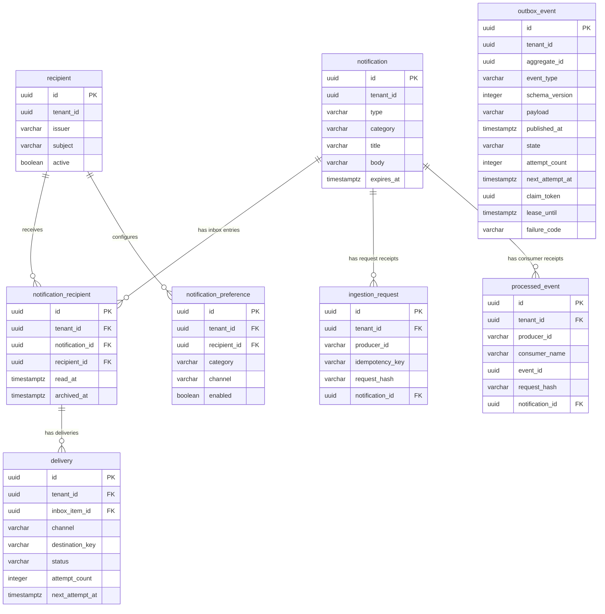

# Notification Service ER diagram

[Documentation index](../README.md) · [Domain model](domain-model.md)

This diagram describes the implemented schema through V5, not the future delivery architecture.
Java `InboxItem` maps to `notification_recipient`.

## Entity relationships



`||` means exactly one; `o{` means zero or many. Each child has exactly one
parent for each relationship shown. The schema permits a parent with no children;
an ingestion service may impose stronger requirements transactionally.

All eight tables also contain `version bigint`, `created_at timestamptz`,
`updated_at timestamptz`, `created_by varchar(512)` and
`updated_by varchar(512)`. They are omitted from the diagram for readability.
`TenantEntity` and `AuditedEntity` are mapped superclasses, not separate tables.
Timestamps represent absolute instants; application JSON displays
`Asia/Phnom_Penh` (+07:00).

## Relationships

| Relationship | Meaning |
|---|---|
| Notification 1 → 0..N inbox entries | One content snapshot can be addressed to multiple recipients. |
| Recipient 1 → 0..N inbox entries | A recipient has independent read/archive state for each notification. |
| Inbox entry 1 → 0..N deliveries | Each channel/destination has its own delivery progress. Multiple push devices can have separate deliveries. |
| Recipient 1 → 0..N preferences | A recipient can configure a preference for each category/channel pair. |
| Notification 1 → 0..N ingestion receipts | Accepted producer requests retain their original result for retries. |
| Notification 1 → 0..N processed events | Multiple events may resolve to the same idempotent request result. |

Together, the first two relationships model notification-to-recipient many-to-many.
The join is an entity because it owns business state, not just two foreign keys.

`outbox_event.aggregate_id` is currently a logical reference without a database
foreign key. An event may refer to a notification or another aggregate; the event
contract must define that meaning. This is why no FK relationship line connects
the outbox in the diagram. The current schema does not enforce aggregate existence
or tenant consistency for this reference. Application services must establish
those rules and write the outbox row in the business transaction.

`destination_key` is also an opaque logical reference, not an FK: endpoint storage
has not been implemented. There are no tenant, template, endpoint or
delivery-attempt tables in the current schema.

## Database constraints

Each relationship uses a composite FK, not a relationship on the UUID alone:

- Inbox: `(tenant_id, notification_id) → notification(tenant_id, id)`.
- Inbox: `(tenant_id, recipient_id) → recipient(tenant_id, id)`.
- Delivery: `(tenant_id, inbox_item_id) → notification_recipient(tenant_id, id)`.
- Preference: `(tenant_id, recipient_id) → recipient(tenant_id, id)`.
- Both V2 receipt tables: `(tenant_id, notification_id) → notification(tenant_id, id)`.
  These FKs are deferred until commit to allow reservation before business inserts.

The related parent tables have unique `(tenant_id, id)` keys. These FKs reject
cross-tenant references even if application code is bypassed.

Additional uniqueness rules:

| Table | Unique business key |
|---|---|
| recipient | tenant_id, issuer, subject |
| notification_recipient | tenant_id, notification_id, recipient_id |
| delivery | tenant_id, inbox_item_id, channel, destination_key |
| notification_preference | tenant_id, recipient_id, category, channel |
| ingestion_request | tenant_id, producer_id, idempotency_key |
| processed_event | tenant_id, producer_id, consumer_name, event_id |

No cascading delete is declared in the migrations. Deleting a referenced parent is blocked
until its dependent rows are handled explicitly. Audit actors are text identifiers,
not foreign keys to recipients: actors can also be trusted services.

## UUID fields versus JPA object associations

UUID is the identifier type. The actual mapping choice is **scalar ID reference**
versus **object association**. A `@ManyToOne` can also reference a UUID primary key.

Current mapping:

```java
@Column(nullable = false, updatable = false)
private UUID notificationId;
```

Reading `item.getNotificationId()` reads an ID. It never loads a Notification
through ORM relationship traversal. The database FK still enforces existence and
tenant consistency because Flyway, rather than Hibernate schema generation, owns
the schema.

We chose scalar references for these links because:

1. **Independent operations:** marking an inbox entry read needs no notification,
   recipient or delivery object graph.
2. **Potentially large fan-out:** a notification may have many recipients; inbox
   and delivery records can be queried in bounded pages instead of exposed as an
   unbounded entity collection. Paginated list endpoints are not yet implemented.
3. **Explicit persistence:** services determine which records to save and delete.
4. **Explicit query plans:** reads use joins/projections or batched fetches when
   they need data across tables.
5. **Clear module references:** modules can exchange IDs without requiring managed
   JPA objects. This alone does not make them independent microservices.

Tradeoffs:

- No `item.getNotification().getTitle()` navigation; queries must retrieve content.
- JPQL association navigation and association-based entity graphs are unavailable
  for these links; explicit joins/projections are needed.
- Services must coordinate persistence order and transaction boundaries.
- Scalar IDs do not automatically solve N+1 queries: fetching one Notification per
  inbox entry in a loop is still N+1.
- Scalar IDs do not authorize access. Every query still needs tenant and ownership
  checks.

An illustrative read query (not an implemented repository method):

```sql
SELECT i.id, n.title, n.body, i.read_at
FROM app.notification_recipient i
JOIN app.notification n
  ON n.tenant_id = i.tenant_id
 AND n.id = i.notification_id
WHERE i.tenant_id = :tenantId
  AND i.recipient_id = :recipientId
ORDER BY i.created_at DESC, i.id DESC
LIMIT :limit;
```

Production pagination should also apply the current cursor.

## When JPA associations would be appropriate

Associations are useful when navigation is frequent or a bounded child collection
belongs to a parent's lifecycle. A carefully mapped `@ManyToOne(fetch = LAZY)`
could be reasonable here if read requirements warrant it. It would need
tenant-aware join columns and a fetch plan.

A `@ManyToOne` does not require a reverse `@OneToMany`. Cascades are opt-in;
the annotations do not inherently delete or persist related entities. Fetch joins,
entity graphs and batching can make association-based reads efficient.

Scalar IDs are a deliberate choice for this foundation, not a rule that JPA
associations are bad. Neither choice changes the schema's normalization level.

## References

- [Foundation migration](../../src/main/resources/db/migration/V1__notification_foundation.sql)
- [Ingestion migration](../../src/main/resources/db/migration/V2__idempotent_ingestion.sql)
- [Ingestion and deduplication guide](../development/idempotent-ingestion.md)
- [Hibernate association guidance](https://github.com/hibernate/hibernate-orm/blob/main/documentation/src/main/asciidoc/introduction/Entities.adoc)
- [Hibernate fetching guidance](https://github.com/hibernate/hibernate-orm/blob/main/documentation/src/main/asciidoc/userguide/chapters/fetching/Fetching.adoc)

V5 outbox lifecycle, indexes, and worker-only mutation rules are described in the
[outbox guide](../development/outbox-publication.md).
