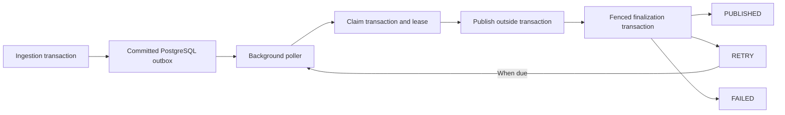

# Phase 2: Reliable asynchronous event processing

[Documentation index](../README.md) | [Operations](../operations/outbox-publication.md)

## Scope and guarantees

Phase 2 implements an opt-in outbox processing and publication framework. Tests use
simulated transport acknowledgment. No real broker adapter or default success adapter
is shipped; external broker publication, email, push, and SSE remain future work.

Ingestion still atomically writes notification, inbox, receipt, and outbox. REST
contracts, request fingerprints, event deduplication, and recipient preferences are
unchanged. A committed outbox UUID is the stable publication ID across retries.
`notification.created` remains schema version 1 with its original payload.

Publication may be repeated after a lost acknowledgment or crash. Consumers must
deduplicate by stable event ID. At-least-once processing does not imply exactly-once
external delivery or guaranteed delivery after the bounded attempt budget is exhausted.
No global, tenant, or aggregate ordering guarantee is offered.

## Core concepts

Phase 2 is **Reliable Asynchronous Event Processing using the Transactional Outbox
Pattern**. The ingestion transaction records durable intent; independently scheduled
workers process committed events without any HTTP request to trigger publication.
Automatic processing starts only after explicit worker activation, trusted tenant
configuration, restricted database provisioning, and registration of an adapter.

| Concept | Implementation | Evidence |
|---|---|---|
| Background processing | Lifecycle-started scheduler polls durable events independently of REST controllers | Enabled-worker ingestion test and worker scheduling tests |
| Claiming and concurrency | Short row-locking transaction establishes a single valid claim token | Concurrent workers receive disjoint claims; locked rows are skipped |
| Leases and crash recovery | Database-time leases expire; recovery assigns a fresh token; stale finalization is fenced | Expired/superseded workers cannot mutate state; crash exhaustion is persisted |
| Publisher abstraction | OutboxPublisher accepts the stable envelope and returns classified outcomes | Test adapters exercise outcomes without RabbitMQ/Kafka dependencies |
| Retry and failure handling | Capped exponential backoff with jitter; persisted attempts; terminal FAILED state | Retry timing, permanent rejection, and maximum-attempt tests |
| At-least-once and idempotency | Stable event ID on every attempt; acknowledgment precedes fenced success; existing ingestion replay preserved | Lost-acknowledgment duplicate test and active-worker ingestion/replay test |
| Multi-tenant security and auditing | Trusted tenant allowlist, transaction-local context, forced RLS, restricted worker role, explicit audit/version updates | Restricted-role, cross-tenant, connection-reuse, and audit tests |

A valid claim is exclusive; physical external calls can still overlap after lease
expiry. An old call cannot finalize database state, but may reach the destination.
Downstream consumers must deduplicate the stable event ID within their own business
transaction. Existing ingestion deduplication does not by itself deduplicate future
external consumer side effects. No such broker consumer is shipped in Phase 2.

Only due RETRY events return to claiming; FAILED records require a separately
authorized recovery process. Expired PROCESSING claims also return to recovery
while attempt budget remains. No event is promised eventual delivery after the
retry limit is exhausted.

## Components and transaction boundaries

- `OutboxConfiguration`: validates enablement/configuration/adapter and checks a
  dedicated `crud_outbox` login before creating the worker.
- `OutboxStore`: owns JDBC transactions on the worker pool; it does not replace
  Spring Boot's API datasource or JPA transaction manager.
- `OutboxWorker`: round-robin tenant polling, bounded transport capacity, timeout
  classification, graceful shutdown, counters, timers, and sampled backlog gauges.
- `OutboxPublisher`: transport contract returning ACKNOWLEDGED, RETRYABLE,
  PERMANENT, or UNKNOWN. ACKNOWLEDGED requires explicit destination acceptance.
- `RetryBackoff`: capped exponential delay with equal jitter.

Claim transaction: set the authorized tenant locally, lock a bounded eligible batch
with FOR UPDATE SKIP LOCKED, increment attempts, assign fresh UUID claim tokens and
leases, then commit. Only configured tenants are visited; no unscoped discovery occurs.

Publish outside the database transaction. Then finalize in a fresh transaction with
fresh tenant context. Lock the claimed row and recheck token, state, and database
lease time after any lock wait. An expired/superseded claim changes nothing.

The worker pool is encapsulated rather than exposed as a default DataSource bean.
Every protected statement uses set_config(..., true) on its transaction's own
connection. Context clears on commit and rollback. FORCE RLS stays enabled.

## Lifecycle

| From | Condition | To |
|---|---|---|
| PENDING | Capacity and authorized tenant | PROCESSING |
| RETRY | Retry due | PROCESSING |
| PROCESSING | Explicit acknowledgment and valid claim | PUBLISHED |
| PROCESSING | Retryable/unknown outcome, budget remains | RETRY |
| PROCESSING | Permanent failure or budget exhausted | FAILED |
| Expired PROCESSING | Budget remains | PROCESSING with new token |
| Expired PROCESSING | Budget exhausted | FAILED |

Attempts count acquired claims, including claims abandoned before an actual send.
Counts persist across restarts. Normal polling cannot requeue terminal events.
The store rejects invalid finalizations; database constraints reject inconsistent
state/lease/retry/publication timestamps. Direct privileged SQL is not a supported
state-transition API. The old unfenced entity markPublished method has been removed.

On each successful worker update, native SQL sets updated_by to
`service:outbox-publisher`, updates updated_at, and increments version. Creation audit,
identity, tenant, and payload are immutable to the worker role. Native SQL does not
invoke JPA auditing listeners, so this maintenance is explicit.

## Timeout and shutdown

Adapters must set bounded network timeouts and honor interruption. The worker also
bounds its acknowledgment wait. A timeout becomes UNKNOWN, never success. Database
fencing cannot prevent an already-running external request from reaching its destination.

Capacity stays reserved until both transport execution and its controller finish.
An adapter ignoring interruption can consume all capacity, but cannot cause unlimited
queued publication calls. Monitor progress and repair the adapter before restarting.

Shutdown closes a short dispatch gate, interrupts the scheduler, waits at most the
configured grace period for controllers, then cancels unfinished publication tasks.
It never waits on the poller's database I/O. A claim operation already in flight may
still commit, but cannot dispatch after shutdown; its lease remains recoverable.
The database pool is closed separately during resource destruction and may require
its own bounded cleanup time. FutureTask cancellation targets the specific task;
a late completion cannot replace an UNKNOWN outcome or interrupt a reused thread. Runtime disablement takes effect
on application restart, not dynamic configuration refresh.

## Observability

- outbox.attempts: bounded outcome tags (acknowledgment or classified failure).
- outbox.finalizations: APPLIED or FENCED.
- outbox.errors: poll or finalize; exception bodies are not logged.
- outbox.processing: controller duration, including acknowledgment wait/finalization.
- outbox.events: sampled counts by state across configured tenants.
- outbox.expired.leases: sampled expired PROCESSING count.
- outbox.oldest.unpublished.seconds: maximum sampled age, including FAILED records.

Gauges refresh per visited tenant when capacity is available; they are not a live
SQL view and can be stale while transports are stuck. Initial unsampled counts are
zero. No tenant/event/recipient labels or payloads are exported. Existing actuator
exposure remains health/info; wiring a registry does not expose a metrics endpoint.

## Tests and limits

Run `./gradlew.bat test jacocoTestReport --console=plain --max-workers=1` with Docker.
See [verification evidence](outbox-verification.md) for scenario mappings.
Tests use disposable PostgreSQL 18.7 and test-only adapters. They do not apply V5,
create a worker login, or activate publication in the persistent local database.

Real broker acknowledgment semantics, downstream deduplication, performance under
production load, and recovery operations beyond terminal inspection remain unverified.
